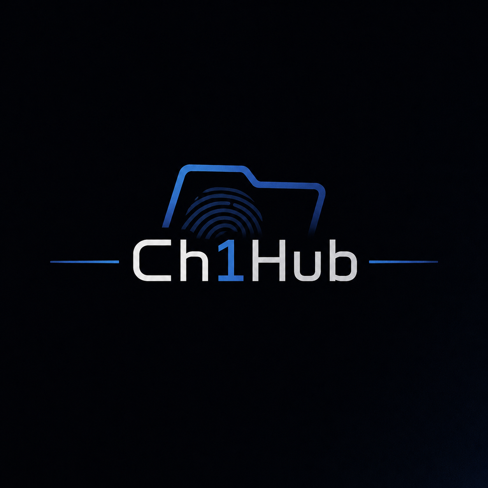

#<div align="center">
 # 

  <h1>Chikhaoui Youcef Chihab Eddine</h1>

  <p><strong>Blue Team · Digital Forensics · Incident Response</strong></p>

  <p>
    Cybersecurity engineering student in the final year at <a href="https://www.esi-sba.dz/">ESI-SBA</a>, Algeria.<br>
    I investigate what happened, reconstruct it from the artefacts left behind, and build the detections that catch it next time.
  </p>

  <p>
    <a href="https://dz.linkedin.com/in/youcef-chihab-eddine-chikhaoui-442343264"></a>
    <a href="mailto:chihab.chikhaoui@gmail.com"></a>
    <a href="https://tryhackme.com/p/Ch1Hub"></a>
    <a href="https://cyberdefenders.org/p/Ch1Hub"></a>
    <a href="https://ctftime.org/team/373233"></a>
  </p>
</div>

---

```console
$ whoami
chihab · cybersecurity engineer · final year @ ESI-SBA · Algeria

$ cat focus.txt
blue team operations
digital forensics
incident response
SOC monitoring
detection engineering
malware analysis

$ ./status --now
[+] completing the engineering degree in cybersecurity
[+] TryHackMe SOC path · CyberDefenders investigation labs
[+] leading Vuln3ra, a DFIR-focused CTF team
[+] open to SOC / DFIR / incident response opportunities
```

I work on the defensive side of security: reconstructing attacker activity from disk, memory, logs and network traffic, and turning what I learn into detections. I also build and ship full-stack software — knowing how systems are made is what makes it possible to understand how they break.

## Focus areas

<table>
  <tr>
    <td width="33%" valign="top">
      <h3>SOC &amp; monitoring</h3>
      <p>Alert triage, log analysis and packet inspection — turning a suspicious event into a documented, defensible verdict.</p>
      <sub>Zeek · Snort · Wireshark · Windows event logs</sub>
    </td>
    <td width="33%" valign="top">
      <h3>Digital forensics</h3>
      <p>Disk images, timelines, evidence integrity and Windows artefacts — reconstructing what happened, in what order, and with what impact.</p>
      <sub>Autopsy · SIFT · Sleuth Kit · event logs</sub>
    </td>
    <td width="33%" valign="top">
      <h3>Incident response</h3>
      <p>Working an incident through the PICERL cycle: identification, containment, eradication, recovery and the lessons that follow.</p>
      <sub>PICERL · triage · containment · reporting</sub>
    </td>
  </tr>
  <tr>
    <td width="33%" valign="top">
      <h3>Detection engineering</h3>
      <p>Detection content that survives real traffic: flow features and ML models, YARA rules and Zeek scripts — measured instead of assumed.</p>
      <sub>YARA · Zeek · LightGBM · CatBoost</sub>
    </td>
    <td width="33%" valign="top">
      <h3>Malware analysis</h3>
      <p>Static triage of real samples in an isolated lab: PE inspection, strings, entropy, disassembly and the IOCs that feed back into detection.</p>
      <sub>PE inspection · FLOSS · YARA · IOCs</sub>
    </td>
    <td width="33%" valign="top">
      <h3>Automation &amp; infrastructure</h3>
      <p>Python and Bash tooling, Dockerised labs, CI/CD and self-hosted infrastructure — defensive work should be repeatable, not heroic.</p>
      <sub>Python · Bash · Docker · GitHub Actions</sub>
    </td>
  </tr>
</table>

## Toolbelt

**Blue team &amp; DFIR**

<p>
  
  
  
  
  
  
  
  
</p>

**Offensive — for context**

<p>
  
  
  
  
  
  
</p>

**Languages &amp; development**

<p>
  
  
  
  
  
  
</p>

**Infrastructure**

<p>
  
  
  
  
  
  
  
  
  
  
</p>

## Selected repositories

| Repository | What is inside |
| --- | --- |
| [**digital-forensics-labs**](https://github.com/Ch1Hub/digital-forensics-labs) | Four DFIR practicals: SIFT/Autopsy timelines, a 64 MB synthetic disk image, the ORION evidence bundle and Windows event-log analysis. |
| [**malware-analysis-labs**](https://github.com/Ch1Hub/malware-analysis-labs) | Static analysis of a real downloader and AgentTesla: PE inspection, FLOSS strings, entropy, disassembly, YARA rules and reports — no live samples. |
| [**ai-for-cybersecurity-labs**](https://github.com/Ch1Hub/ai-for-cybersecurity-labs) | Detection engineering with ML: UNSW-NB15 supervised detection, ML versus hand-written rules, and CICIDS2017 anomaly detection. |
| [**Lightweight-NIDS-with-Zeek-Machine-Learning**](https://github.com/Ch1Hub/Lightweight-NIDS-with-Zeek-Machine-Learning) | Zeek + LightGBM + CatBoost NIDS: 22 flow features, JSON alerts, and 99.6% recall with 0.5% false positives on the reported evaluation. |
| [**web-security-labs**](https://github.com/Ch1Hub/web-security-labs) | The offensive side, for context: 44 Dockerised vulnerable applications covering SSRF, injection, access control, IAM and DevSecOps. |
| [**CyberSec-at-ESI**](https://github.com/Ch1Hub/CyberSec-at-ESI) | The full two-year archive: 21 topics, 79 practicals, 1,788 files and a dated history from October 2025 to November 2026. |

## CTF &amp; community

- **Team leader — [Vuln3ra](https://ctftime.org/team/373233)** · leading an active CTF team with a digital-forensics and incident-response focus, competing onsite and online.
- **3rd place — FennecCTF** · recognised by Algeria's Ministry of Post and Telecommunications.
- **Challenge author** · DFIR and forensics challenges for SecAI Internal CTF, and forensics challenges for IngeHack.
- **Infrastructure lead — NumidianCTF** · built the CTFd platform and Docker challenge infrastructure — distributed workers, elastic scaling, TLS/SNI routing for TCP challenges — and kept it running through the full 36-hour event.
- **President — INGENIUMS Scientific Club, 2024–2025** · ran a full season and seven major events, including the club's flagship IngeHack CTF; alumni advisor since 2025.
- **Business Leader — ACS Club** · partnerships and outreach; former technical team member at GDG Sidi Bel Abbès.

## GitHub

<p align="center">
  
  
</p>

---

<p align="center">
  <strong>Open to SOC, DFIR and incident-response opportunities.</strong><br>
  <sub>Algeria · <a href="mailto:chihab.chikhaoui@gmail.com">chihab.chikhaoui@gmail.com</a> · <a href="https://dz.linkedin.com/in/youcef-chihab-eddine-chikhaoui-442343264">LinkedIn</a> · <a href="https://github.com/Ch1Hub">GitHub</a></sub>
</p>
